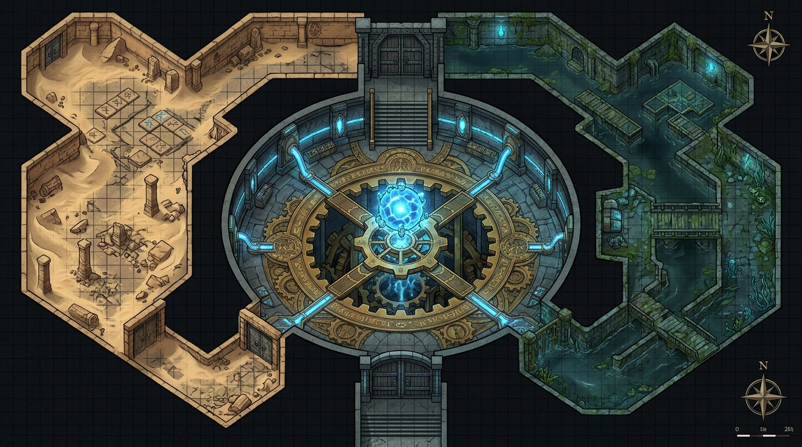

# Playtest Scenario: The Sunken Vault of Ascore

A competitive, multi-party tactical dungeon playtest designed for the **RoL d20** ruleset.

---

## 1. Setting & Briefing: The Sunken Vault of Ascore

### Background Lore
**Ascore** was once the colossal pyramid-port of ancient Delzoun on the shores of the Narrow Sea, built in cooperation with Netherese arcanists. When Netheril fell and the Narrow Sea vanished into the sands of the expanding Anauroch desert, Ascore withered into petrified bone-white stone. 

Deep beneath the city's sunken wharves lies the **Vault of the Brass Cog**, a buried subterranean hydraulic and arcane pumping station. Inside rests a dormant **Netherese Mythallar Core**, still pulsing with raw, unfiltered magical energy that holds back both the crushing weight of shifting desert dunes above and an ancient subterranean aquifer below.

### The Premise
Two rival adventuring companies have breached the complex simultaneously from opposing approaches:
* **The West Wing (Dune Breach)**: Breached from the desert sands through collapsed sandstone arches. Dominated by suffocating heat, shifting sand drifts, crumbling masonry, and ancient dwarven defense machinery.
* **The East Wing (Aquifer Crypts)**: Infiltrated through subterranean river caves beneath the dry seabed. Characterized by waist-deep dark water, slick algae, flooded corridors, and ancient water-pressure locks.
* **The Central Sanctum (The Mythallar Cistern)**: A massive circular amphitheater where the two wings converge over colossal interlocking brass cogs and a levitating, unstable mythallar sphere.

---

## 2. Dungeon Layout & Tactical Map



### Spatial Flow Diagram

```
           [WEST INGRESS]                                     [EAST INGRESS]
       Dune Breach (Sand Drifts)                          Aquifer Crypts (Water)
                  │                                                  │
                  ▼                                                  ▼
     ┌────────────────────────┐                         ┌────────────────────────┐
     │ Room W1: Sifting Churn │                         │ Room E1: Drowned Canal │
     │  (Sand Traps, Ghouls)  │                         │  (Flooding, Water Elem)│
     └───────────┬────────────┘                         └───────────┬────────────┘
                 │                                                  │
                 ▼                                                  ▼
     ┌────────────────────────┐    Resonance Mirror     ┌────────────────────────┐
     │ Room W2: Golem Foundry │◄═══════════════════════►│ Room E2: Shadow Crypt  │
     │  (Antimagic Siphon)    │    (Scrying / Taunts)   │  (Wild Magic / Darkness│
     └───────────┬────────────┘                         └───────────┬────────────┘
                 │                                                  │
                 ▼                                                  ▼
     ┌────────────────────────┐    Cross-Sluice Valve   ┌────────────────────────┐
     │ Room W3: Piston Gallery│◄═══════════════════════►│ Room E3: Steam Gate    │
     │  (Reach / Chokepoint)  │    (Environmental Shift)│  (Akimbo / Ambush)     │
     └───────────┬────────────┘                         └───────────┬────────────┘
                 │                                                  │
                 └───────────────────────┐  ┌───────────────────────┘
                                         ▼  ▼
                              ┌───────────────────────┐
                              │  THE CENTRAL SANCTUM  │
                              │  Mythallar Cistern    │
                              │ (Merged Co-GM Table)  │
                              └───────────────────────┘
```

---

## 3. Room Encounters & Targeted Rule Checks

### West Wing (Dune Breach — Party 1 Approach)

#### Room W1: The Sifting Churn
* **Environment**: 3-foot deep sand drifts (difficult terrain, +1 AP movement cost for non-skirmishers).
* **Encounter**: 4 **Dust Ghasts** hiding beneath the sand.
* **Mechanics Tested**:
  * **Surprise & Ambush**: Hidden enemies rolling Stealth vs. Passive Perception Defenses.
  * **Disease & Insidious Damage**: Ghast claws inflicting ghoul fever and persistent paralyzing toxins.
  * **Action Points in Difficult Terrain**: Managing AP when movement costs double.

#### Room W2: The Golem Foundry & Antimagic Siphon
* **Environment**: Ancient dwarven forge with a central Netherese siphon pylon.
* **Hazard**: The pylon emits a pulsing **Antimagic Field** on odd combat rounds, suppressing all magical buffs, weapon enchantments, and spells.
* **Encounter**: 1 **Dwarven Iron Automaton** (High DR, heavy bludgeoning resistance, sweep attacks).
* **Mechanics Tested**:
  * **Natural DR & Weapon Material Bypass**: Testing Adamantine bypass vs. heavy physical DR.
  * **Mundane Martial Reliance**: Casters forced to use physical weapons or mundane tools during antimagic pulses.
  * **Grappling & Brawling**: Attempting to pin or manipulate the pylon levers.

#### Room W3: The Piston Gallery
* **Environment**: Narrow corridor flanked by massive oscillating brass pistons (hazards).
* **Encounter**: 3 **Ascore Sentry Constructs** armed with 10-foot reach poleaxes.
* **Mechanics Tested**:
  * **Reach & Chokepoint Defense**: Testing whether a halberd/polearm user can lock down a corridor.
  * **Pushing & Forced Movement**: Shoving enemies into crushing pistons.

---

### East Wing (Aquifer Crypts — Party 2 Approach)

#### Room E1: The Drowned Canal
* **Environment**: 4-foot deep brackish water, partially submerged walkways, zero natural light.
* **Encounter**: 2 **Murk Drowned** and 1 **Tainted Water Elemental**.
* **Mechanics Tested**:
  * **Underwater / Waterlogged Combat**: Melee penalties for slashing/bludgeoning vs. piercing weapons; swim checks (Athletics) in armor.
  * **Combat in Darkness**: Testing darkvision ranges, blindsight, and light spell placement.
  * **Vital Strikes in Water**: Rogue/Infiltrator positioning from submerged stealth.

#### Room E2: The Shadow Crypt & Wild Magic Well
* **Environment**: Sunken burial vault radiating unstable Netherese radiation.
* **Hazard**: **Wild Magic Zone**. Every spell or psionic manifestation rolled on an open-ended `d20!` table triggers unpredictable surges (teleportation, elemental shifts, or PP/slot drain).
* **Encounter**: 4 **Shadow Wraiths** that deal insidious strength damage through armor DR.
* **Mechanics Tested**:
  * **Wild Magic Mechanics & d20! Open-Ended Cascades**.
  * **Psionics vs. Arcane in Anomalous Zones**: Testing how Power Points interact with wild surges.
  * **Insidious / Persistent Damage**: Handling non-lethal stat drain vs. HP reduction.

#### Room E3: The Steam Gate
* **Environment**: Dense superheated steam clouds causing partial concealment (20% miss chance / Defense bonus).
* **Encounter**: 4 **Clockwork Stalkers** attacking with rapid dual blades (akimbo).
* **Mechanics Tested**:
  * **Akimbo / Multi-Attack AP Balancing**: Rapid multi-strikes vs. player armor DR.
  * **Concealment & Vital Strikes**: Using steam for hit-and-run tactics.

---

### Cross-Wing Interactive Mechanics (Co-Pilot GM Triggers)

1. **The Resonance Mirror (Rooms W2 & E2)**:
   * A circular scrying crystal connecting both rooms. For 1 AP, a character can gaze into the mirror to see and hear the rival party's progress, exchange verbal taunts, or cast divination/telepathy spells across the wings.
2. **The Cross-Sluice Valve (Rooms W3 & E3)**:
   * A heavy wheel valve. Cranking it (Athletics check, 3 AP):
     * *West Crank*: Drains sand from Room W3 and dumps 5 tons of sludge into Room E3, creating sudden difficult terrain and extinguishing torches on the East side!
     * *East Crank*: Opens floodgates that wash clean water into West Wing, flushing away sand drifts but soaking West party gear and sparking electrical traps!
3. **The Alarm Chime**:
   * Any loud thunder spell or detonated explosive alerts the **Central Vault Guardian**, giving it pre-buff defensive wards before either party arrives.

---

### Central Sanctum: The Mythallar Cistern (Merged Table Climax)

* **Physical Layout**: A 100-foot diameter circular chamber. Four concentric brass gear rings rotate at different speeds over a 60-foot drop into the ancient aquifer. The **Mythallar Core** floats 15 feet in the air at the exact center.
* **Co-Pilot GM Roles**:
  * **GM 1 (Environment & Boss)**: Tracks rotating gear platforms, lair hazards (arcing blue lightning), and runs the **Netherese Mythallar Custodian** (CR 10 construct).
  * **GM 2 (Player Coordination & PvP)**: Manages line-of-sight between Party A and Party B, adjudicates cross-table reactions, and tracks AP order.
* **Victory Conditions**:
  1. *Mercenary Triumph*: Extract the 3 Mythallar Rods (requiring Arcana/Engineering checks, 2 AP each) and escape.
  2. *Domination (PvP)*: Incapacitate or force the rival party to surrender.
  3. *Stabilization Alliance*: Parties combine forces to shut down the overloading core before it detonates the entire mountain.

---

## 4. Suggested Party Compositions (Level 8 Benchmark)

To test the widest possible breadth of the ruleset, the two parties are deliberately designed as contrasting paradigms:

```
┌─────────────────────────────────────────────────────────────────────────────┐
│                       PARTY COMPOSITION ARCHITECTURE                        │
├──────────────────────────────────────────┬──────────────────────────────────┤
│ PARTY A: "THE TRADITIONALISTS"           │ PARTY B: "THE EXOTICS"           │
│ (All RL = 0, CL = 8)                     │ (RL > 0 Races & Templates, CL < 8)│
├──────────────────────────────────────────┼──────────────────────────────────┤
│ 1. Shield Dwarf Fighter 8 (Juggernaut)   │ 1. Half-Dragon Goliath Barbarian │
│    - Heavy Armor DR, Tower Shield, Reach │    (RL 3 / CL 5 - Brawler/Brute) │
│ 2. Human Cleric of Helm 8 (Bulwark)      │ 2. Fey'ri Rogue Infiltrator      │
│    - Divine Buffs, Radiant AoE, Defenses │    (RL 2 / CL 6 - Flight/Akimbo) │
│ 3. Halfling Rogue / Scout 8 (Skirmisher) │ 3. Fire Genasi Psion/Kineticist  │
│    - Akimbo, Vital Strike, Mobility, AP  │    (RL 1 / CL 7 - Power Points)  │
│ 4. Moon Elf Wizard 8 (Arcanist)          │ 4. Drow Shadow Cleric            │
│    - Control Spells, Burst AoE, Counter  │    (RL 2 / CL 6 - Darkness/Reach)│
└──────────────────────────────────────────┴──────────────────────────────────┘
```

---

### Party A: "The Traditionalists" (ECL 8 — Standard Races & Classes)

#### 1. Bromm Ironbreaker — Shield Dwarf Fighter 8
* **Race Level (RL) / Class Level (CL)**: RL 0 / CL 8
* **Build Archetype**: Heavy Tank & Chokepoint Bulwark
* **Equipment**: Dwarven Full Plate (High DR), Masterwork Tower Shield, Dwarven Waraxe, Guisarme (Reach weapon).
* **Key Mechanics Tested**:
  * **Armor DR vs. Ingress Damage**: Testing how physical DR mitigates multiple smaller attacks vs. large blows.
  * **Reach & Attack of Opportunity Zoning**: Locking down corridors using the Guisarme's 10-foot reach.
  * **AP Allocation**: Deciding whether to spend 3 AP on a full combo attack or reserve 1–2 AP for defensive reactions and shield blocks.

#### 2. Justinian Vance — Human Cleric of Helm 8
* **Race Level (RL) / Class Level (CL)**: RL 0 / CL 8
* **Build Archetype**: Divine Battlecaster & Guardian
* **Equipment**: Half-Plate, Heavy Steel Shield, Heavy Flail, Holy Symbol of Helm.
* **Key Mechanics Tested**:
  * **Divine Pre-Buffing & Duration Overhead**: Pre-casting *Bless*, *Prayer*, and *Shield of Faith*; tracking AP costs during combat.
  * **Attacks vs. Defenses**: Casting *Radiant Burst* and *Hold Person* targeting enemy Reflex/Will Defenses.
  * **Condition Removal**: Cleansing poisons, diseases, and paralysis inflicted by dungeon hazards.

#### 3. Tilly Quickstep — Lightfoot Halfling Rogue / Scout 8
* **Race Level (RL) / Class Level (CL)**: RL 0 / CL 8
* **Build Archetype**: High-Mobility Akimbo Skirmisher & Trapfinder
* **Equipment**: Studded Leather, Dual Shortswords (Akimbo), Composite Shortbow, Masterwork Thieves' Tools.
* **Key Mechanics Tested**:
  * **Akimbo Strike AP Economy**: Evaluating the exact AP cost and damage balance of dual-wielding light weapons vs. two-handers.
  * **Vital Attacks from Concealment**: Hiding behind terrain, rolling Stealth checks, and striking vulnerable spots.
  * **Trap Disarm & Hazards**: Disarming complex mechanical and arcane triggers under round-by-round time pressure.

#### 4. Aerithal Sunwhisper — Moon Elf Wizard (Evoker/Transmuter) 8
* **Race Level (RL) / Class Level (CL)**: RL 0 / CL 8
* **Build Archetype**: Arcane Artillery & Battlefield Controller
* **Equipment**: Mage Robes, Quarterstaff, Spellbooks, Wands, Scroll Pouches.
* **Key Mechanics Tested**:
  * **Damage Spells vs. Control Spells**: Comparing the tactical value of *Fireball* (pure damage) vs. *Web* / *Slow* / *Stinking Cloud* (control).
  * **Preparation Overhead**: Managing memorized spell lists under dungeon attrition.
  * **Passive Defense Math**: Resolving area spell attacks against monster Defenses.

---

### Party B: "The Exotics" (ECL 8 — Non-Traditional Species & Templates)

#### 1. Karkaz the Cinder-Blooded — Half-Brass Dragon Goliath Barbarian/Brawler
* **Race Level (RL) / Class Level (CL)**: **RL 3 / CL 5** (Total ECL 8)
* **Build Archetype**: Monstrous Brawler, Grappler & Elemental Striker
* **Racial Traits / Template**: Large-framed Goliath (Powerful Build), Half-Dragon (Natural Armor DR +3, Fire Immunity, Sleep/Paralysis Immunity, 1/day Fire Breath weapon).
* **Equipment**: Spiked Greatclub (Two-handed Heavy), Spiked Cestus (Unarmed/Brawling), Padded Furs.
* **Key Mechanics Tested**:
  * **RL Balance Verification**: Testing whether higher base stats, natural DR, and breath weapon compensate for having 3 fewer class levels and lower base attack bonuses.
  * **Grappling & Brawling Maneuvers**: Grabbing, pinning, and hurling enemies into hazard machinery.
  * **Heavy Two-Handed DPS**: Rolling high-dice heavy weapon damage against armor DR.

#### 2. Vespera Nightwing — Fey'ri (Daemonfey) Arcane Infiltrator
* **Race Level (RL) / Class Level (CL)**: **RL 2 / CL 6** (Total ECL 8)
* **Build Archetype**: Winged Aerial Skirmisher & Arcane Trickster
* **Racial Traits / Template**: Planetouched Elven-Fiend hybrid. Bat-like wings (Fly speed), Fire Resistance, Innate *Alter Self* and *Detect Thoughts*.
* **Equipment**: Mithral Chain Shirt, Elven Thinblade (Rapier), Hand Crossbow with poisoned bolts.
* **Key Mechanics Tested**:
  * **Flight & 3D Mobility**: Utilizing vertical clearance in the 40-foot tall chambers to bypass floor hazards.
  * **Innate Poison Application**: Coating bolts with Drow knock-out poison or centipede venom to test insidious poison rules.
  * **Fiendish Resistances**: Testing how innate energy resistance interacts with dungeon elemental traps.

#### 3. Ignis Mindspark — Fire Genasi Psion (Kineticist)
* **Race Level (RL) / Class Level (CL)**: **RL 1 / CL 7** (Total ECL 8)
* **Build Archetype**: Pure Psionic Battery & Thermal Manipulator
* **Racial Traits / Template**: Planetouched Fire Genasi (Fire Resistance, Darkvision, Innate *Produce Flame*).
* **Equipment**: Fine Silk Robes, Crystal Focus Staff, Dorjes (Psionic wands).
* **Key Mechanics Tested**:
  * **Psionic Power Point (PP) Resource Management**: Tracking PP expenditure flexibility vs. traditional Vancian spell slots.
  * **Componentless Casting**: Manifesting powers while grappled, silenced, or in water without verbal/somatic restrictions.
  * **Thermal Control**: Boiling water in the East Wing or manipulating superheated steam in Room E3.

#### 4. Selussa Do'Urden — Drow Shadow Cleric (Vhaeraun / Eilistraee)
* **Race Level (RL) / Class Level (CL)**: **RL 2 / CL 6** (Total ECL 8)
* **Build Archetype**: Darkness Manipulator & Dual Fencer
* **Racial Traits / Template**: Dark Elf (Superior Darkvision 120 ft., Sunlight Sensitivity, Magic Resistance, Innate *Dancing Lights*, *Darkness*, *Faerie Fire*).
* **Equipment**: Drow Piwafwi (Cloak of Stealth), Drow Chainmesh, Twin Masterwork Rapiers (Akimbo finesse).
* **Key Mechanics Tested**:
  * **Magical Darkness & Blind Combat**: Dropping magical darkness spheres to test how blind-fighting and concealment work under RoL d20 rules.
  * **Magic Resistance (MR)**: Testing the system's MR mechanics against enemy spells and traps.
  * **Dual-Wielding Finesse vs. Armor**: Testing light weapon akimbo attacks against high-DR targets.

---

## 5. Playtest Execution Logbook & Balance Tracker

| Observation Point | Rule / System | Target Benchmark | Actual Observed Result |
| :--- | :--- | :--- | :--- |
| **RL vs. CL Balance** | ECL 8 Scaling | Does the RL 3/CL 5 Half-Dragon feel equal in utility to the CL 8 Fighter? | |
| **Psionics vs. Arcane** | Resource Drain | Does the Psion run out of PP faster or slower than the Wizard runs out of spell slots? | |
| **Armor DR Viability** | Damage Reduction | Does Full Plate DR negate light weapon akimbo attacks too much? | |
| **Defenses Math** | Attacks vs. Defenses | Did spell attacks vs. Fortitude/Reflex/Will feel faster than rolling saves? | |
| **AP Turn Velocity** | Action Economy | Average time to resolve a 4-AP player turn in tactical combat. | |
| **Cross-Sluice Trigger**| Co-GM Coordination | Did the environmental shift cause fun tactical friction between tables? | |
